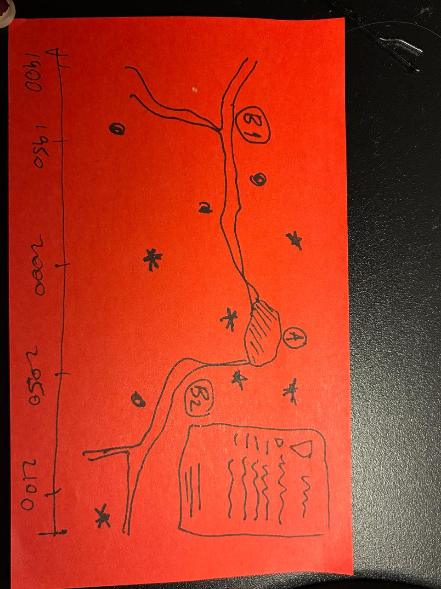

# Explore the watershed

## Description

A glacier, connected river branches and separate actor symbols share an abstract 3D space. The timeline and information panel sit outside the rotating scene.

## Trigger

Open the prototype or switch off relationship lines while actors remain visible. Click a glacier, river or actor.

## Response

Highlight the selected object and open its card. A river card identifies the reach and, if available, the station measuring it. An actor card describes its role and links to its evidence.

## Data

Glacier and river IDs, documented river connections, actor identities, source references and optional dated measurements.

## Remarks

A, B1 and B2 are sketch labels. Match them to verified records before assigning names. Keep the camera stable when opening a card.
