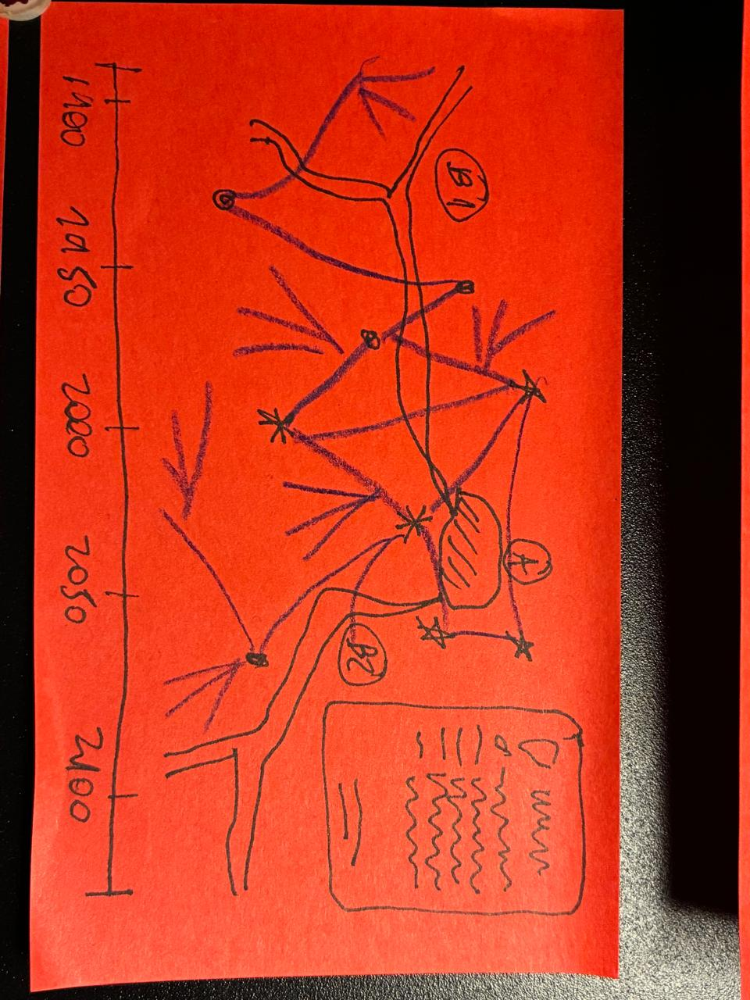

# Explore relationships

## Description

The same scene gains selectable lines between actors and the glacier or river they relate to.

## Trigger

Enable Relationships. Click a line, then click one of its endpoints.

## Response

Highlight the line and both endpoints. Its card names the two entities, explains their connection in plain language and cites the evidence. Selecting an endpoint opens its own card.

## Data

Each link needs two entity IDs, a relationship description and a source. Add a direction, date or numerical value only when documented.

## Remarks

Give thin lines a wider click target. When a layer hides an endpoint, also hide the attached line. Restore it when both endpoints and Relationships are visible.
