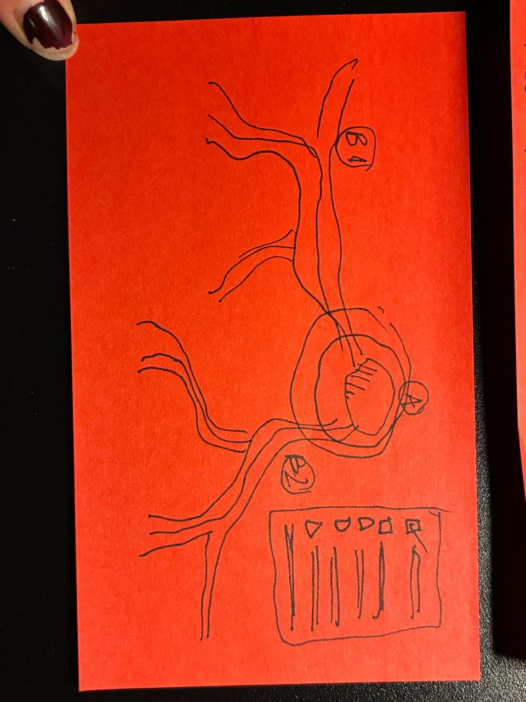

# Compare glacier and river changes

## Description

Actors and links are hidden. Dated glacier outlines can be seen together. River measurements can be compared over the same period.

## Trigger

Hide Actors and Relationships. Select a year on the timeline, then choose a second available date to compare. Click an outline or river.

## Response

Label each outline with its observation date. A click opens the matching record. On a river, show the indicator, period, units and station for each selected date. Mark missing records as unavailable.

## Data

Dated glacier outlines for spatial change. River discharge for changes in flow. Historical river geometry is a separate dataset needed to show channel movement.

## Remarks

Keep a fixed river path when only flow observations exist. Identify dates by labels or line style as well as colour. Future dates in the sketch require sourced projections.
